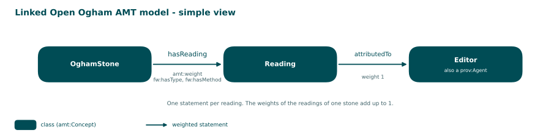

<!-- Generated by main.py (step: docs). Do not edit by hand; edit py/docs_text.py, ontology/ogham-amt.ttl or the data. -->

# Linked Open Ogham: AMT

> **Status: prototype, release 0.4.0.** The model is small on purpose. What is verified and what is still open is stated on the page [Run](run.html).

Ogham stones are read differently by different editors. This repository turns the
competing readings of seven stones, as they stand in the OG(H)AM EpiDoc files, into **weighted statements** in
the vocabulary of the [Academic Meta Tool (AMT)](https://github.com/alpaca-fair-framework/amt-engine). Doubt
is not removed and not hidden in a footnote: every reading becomes one statement, and the weights of the
readings of one stone add up to 1.



Source: [PNG](diagrams/01_model.png), drawn by `py/step_diagrams.py` from the data.

## The three rules

1. **One statement per reading.** The stone is linked to each reading by the role `hasReading`; the
   statement carries a weight.
2. **The weight is computed, not typed.** Reading confidence (from the doubt markup) times tradition
   agreement (how many editors read it alike), normalised per stone.
3. **The kind of doubt is named.** Each statement says whether the weight was lowered by vagueness,
   by uncertainty or by both, using the three types of the
   [Fuzziness-Wobbliness ontology](https://github.com/alpaca-fair-framework/FW_Ontology).

## Pages

| Page | Content |
|---|---|
| [Model](model.html) | The concepts, the role, and one statement as a hextuple |
| [Vocabulary](vocabulary.html) | Every concept, role and method: definition and scope note |
| [Weights](weights.html) | How the weight and its type are computed |
| [Stones](stones.html) | The seven stones: every reading with its weight and type |
| [Run](run.html) | What has been checked, and how to check it with the AMT runner |

## Files

| File | Purpose |
|---|---|
| [`ontology/ogham-amt.ttl`](https://github.com/LinkedOpenOgham/tei--epidoc-amt/blob/main/ontology/ogham-amt.ttl) | The domain model in the AMT vocabulary |
| [`py/step_convert.py`](https://github.com/LinkedOpenOgham/tei--epidoc-amt/blob/main/py/step_convert.py) | EpiDoc to AMT Turtle: readings, weights, types |
| [`out/*.amt.ttl`](https://github.com/LinkedOpenOgham/tei--epidoc-amt/blob/main/out) | 7 graphs with 19 weighted statements |
| [`out/README.md`](https://github.com/LinkedOpenOgham/tei--epidoc-amt/blob/main/out/README.md) | Generated breakdown of the extraction |

## Rebuild

```
python main.py
```

Converts the stones, validates the graphs, draws the diagrams and writes this documentation.
`python main.py --list` shows the steps.
