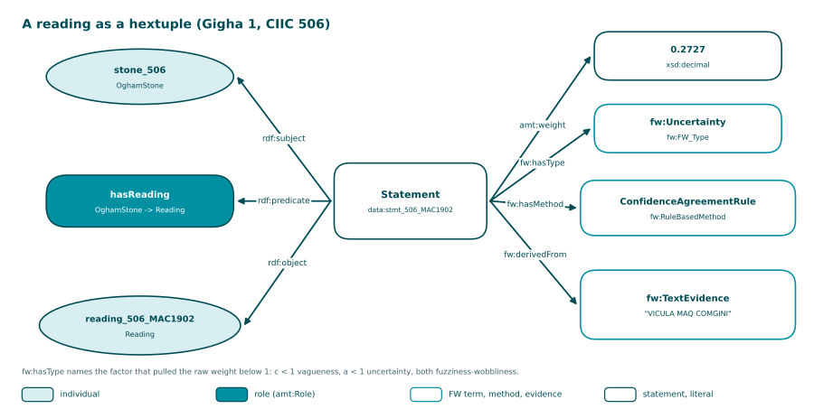

<!-- Generated by main.py (step: docs). Do not edit by hand; edit py/docs_text.py, ontology/ogham-amt.ttl or the data. -->

# Model

The model has two concepts and one role. Nothing is inferred from it: the graphs hold weighted
statements only, no axioms. That is a deliberate choice for this release; the page [Run](run.html) says
what it means for the engine.

## Simple view


Source: [PNG](diagrams/01_model.png), drawn by `py/step_diagrams.py` from the data.

## One statement as a hextuple

AMT stores a weighted statement as a reified triple plus the weight. Release 0.2.0 adds the
three annotations of the hextuple of AMT.engine 0.6.0: the type of the doubt, the method that produced the
weight, and the evidence it was derived from. The quadruple core (subject, predicate, object, weight) is
unchanged; the committed Turtle of release 0.1 and the new Turtle agree on every quadruple.



Source: [PNG](diagrams/02_hextuple.png), drawn by `py/step_diagrams.py` from the data.

The same statement in Turtle, taken from `out/`:

```turtle
data:stmt_506_MAC1902
    rdf:subject    data:stone_506 ;
    rdf:predicate  ogham:hasReading ;
    rdf:object     data:reading_506_MAC1902 ;
    amt:weight     0.2727 ;
    fw:hasType     fw:Uncertainty ;
    fw:hasMethod   ogham:ConfidenceAgreementRule ;
    fw:derivedFrom data:evidence_506_MAC1902 .

data:evidence_506_MAC1902 a fw:TextEvidence ;
    fw:sourceString "VICULA MAQ COMGINI" .
```
