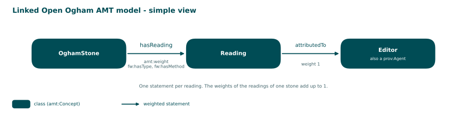
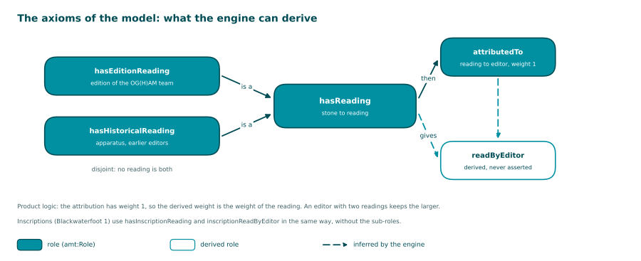

<!-- Generated by main.py (step: docs). Do not edit by hand; edit py/docs_text.py, ontology/ogham-amt.ttl or the data. -->

# Model

The model has four concepts (stone, inscription, reading, editor), seven roles and one plain link
(`hasInscription`, written only for records with several inscriptions). Five axioms say what the engine can
derive from the weighted statements: an edition reading and a historical reading are readings (subsumption), and
a stone, or its inscription, is read by the editor of its reading (role chain, with product logic). The page
[Run](run.html) says what the engine then does.

## Simple view



Source: [PNG](diagrams/01_model.png), drawn by `py/step_diagrams.py` from the data.

## Axioms

The axioms are written in `ontology/ogham-amt.ttl` and copied into every graph, so that the AMT
engine finds them next to the data. They are proposals, to be reviewed (PRIMER S3). The graphs assert the finer
statement (`hasEditionReading` or `hasHistoricalReading`) with the same weight next to the `hasReading`
statement, so that a consumer without the role hierarchy still finds every `hasReading` edge. `readByEditor` is never
asserted: it appears only when the engine reasons.



Source: [PNG](diagrams/06_axioms.png), drawn by `py/step_diagrams.py` from the data.

| Axiom | Kind | Says |
|---|---|---|
| `ogham:AX_editionIsReading` | Subsumption | `hasEditionReading` is a kind of `hasReading` |
| `ogham:AX_historicalIsReading` | Subsumption | `hasHistoricalReading` is a kind of `hasReading` |
| `ogham:AX_inscriptionReadByEditor` | Role chain | `hasInscriptionReading` then `attributedTo` gives `inscriptionReadByEditor` (vocab#ProductLogic) |
| `ogham:AX_readByEditor` | Role chain | `hasReading` then `attributedTo` gives `readByEditor` (vocab#ProductLogic) |
| `ogham:AX_editionOrHistorical` | Disjointness | `hasEditionReading` and `hasHistoricalReading` do not hold of the same pair |

## One statement as a hextuple

AMT stores a weighted statement as a reified triple plus the weight. Release 0.5.0 adds the
three annotations of the hextuple of AMT.engine 0.6.0: the type of the doubt, the method that produced the
weight, and the evidence it was derived from. The quadruple core (subject, predicate, object, weight) is
unchanged; the committed Turtle of release 0.1 and the new Turtle agree on every quadruple.


Source: [PNG](diagrams/02_hextuple.png), drawn by `py/step_diagrams.py` from the data.

The same statement in Turtle, taken from `out/`:

```turtle
data:stmt_506_MAC1902
    rdf:subject    data:stone_506 ;
    rdf:predicate  ogham:hasReading ;
    rdf:object     data:reading_506_MAC1902 ;
    amt:weight     0.2727 ;
    fw:hasType     fw:Uncertainty ;
    fw:hasMethod   ogham:ConfidenceAgreementRule ;
    fw:derivedFrom data:evidence_506_MAC1902 .

data:evidence_506_MAC1902 a fw:TextEvidence ;
    fw:sourceString "VICULA MAQ COMGINI" .
```
