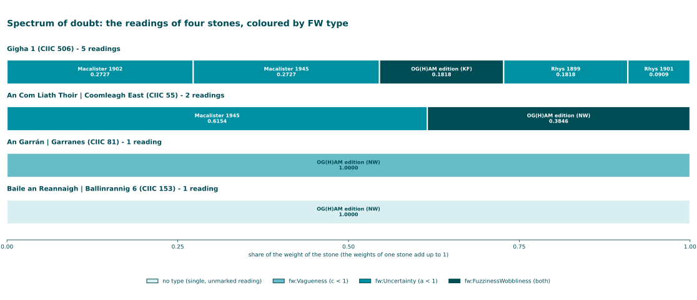
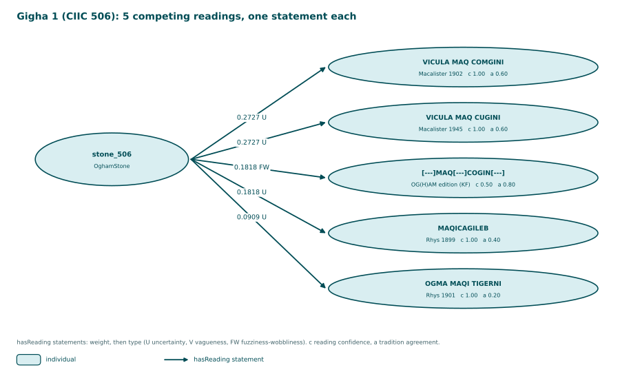

<!-- Generated by main.py (step: docs). Do not edit by hand; edit py/docs_text.py, ontology/ogham-amt.ttl or the data. -->

# Stones

Four stones form a spectrum of doubt, from five competing readings to one unmarked reading.

Source: [PNG](diagrams/05_spectrum.png), drawn by `py/step_diagrams.py` from the data.

## Gigha 1 (CIIC 506)

Graph: [`out/gigha1.amt.ttl`](https://github.com/LinkedOpenOgham/tei--epidoc-amt/blob/main/out/gigha1.amt.ttl)

| Editor | Reading | Doubt signals | c(r) | a(r) | Weight | Type |
|---|---|---|---|---|---|---|
| Macalister 1902 | `VICULA MAQ COMGINI` | proxy: 0 editor-marked char(s) of 16 | 1 − 0 / 16 = **1.00** | 0.60 | **0.2727** | fw:Uncertainty |
| Macalister 1945 | `VICULA MAQ CUGINI` | proxy: 0 editor-marked char(s) of 15 | 1 − 0 / 15 = **1.00** | 0.60 | **0.2727** | fw:Uncertainty |
| OG(H)AM edition (KF) | `[---]MAQ[---]COGIN[---]` | 2× `<unclear>`, 0× `<supplied>`, 3× `<gap>` | 1 − (0.5·2 + 0.7·0 + 1.0·3) / 8 = **0.50** | 0.80 | **0.1818** | fw:FuzzinessWobbliness |
| Rhys 1899 | `MAQICAGILEB` | proxy: 0 editor-marked char(s) of 11 | 1 − 0 / 11 = **1.00** | 0.40 | **0.1818** | fw:Uncertainty |
| Rhys 1901 | `OGMA MAQI TIGERNI` | proxy: 0 editor-marked char(s) of 15 | 1 − 0 / 15 = **1.00** | 0.20 | **0.0909** | fw:Uncertainty |

Source: [PNG](diagrams/04_gigha.png), drawn by `py/step_diagrams.py` from the data.

## An Com Liath Thoir | Coomleagh East (CIIC 55)

Graph: [`out/coomleagh-east.amt.ttl`](https://github.com/LinkedOpenOgham/tei--epidoc-amt/blob/main/out/coomleagh-east.amt.ttl)

| Editor | Reading | Doubt signals | c(r) | a(r) | Weight | Type |
|---|---|---|---|---|---|---|
| Macalister 1945 | `ANM SAINA MAQ OGALA MUCOI TEMOCA` | proxy: 0 editor-marked char(s) of 27 | 1 − 0 / 27 = **1.00** | 0.50 | **0.6154** | fw:Uncertainty |
| OG(H)AM edition (NW) | `.. ? ..TETA` | 1× `<unclear>`, 0× `<supplied>`, 1× `<gap>` | 1 − (0.5·1 + 0.7·0 + 1.0·1) / 4 = **0.62** | 0.50 | **0.3846** | fw:FuzzinessWobbliness |

## An Garrán | Garranes (CIIC 81)

Graph: [`out/garranes.amt.ttl`](https://github.com/LinkedOpenOgham/tei--epidoc-amt/blob/main/out/garranes.amt.ttl)

| Editor | Reading | Doubt signals | c(r) | a(r) | Weight | Type |
|---|---|---|---|---|---|---|
| OG(H)AM edition (NW) | `CASSITTAS MAQI MUCOI CALLITI` | 0× `<unclear>`, 3× `<supplied>`, 0× `<gap>` | 1 − (0.5·0 + 0.7·3 + 1.0·0) / 25 = **0.92** | 1.00 | **1.0000** | fw:Vagueness |

## Baile an Reannaigh | Ballinrannig 6 (CIIC 153)

Graph: [`out/ballinrannig6.amt.ttl`](https://github.com/LinkedOpenOgham/tei--epidoc-amt/blob/main/out/ballinrannig6.amt.ttl)

| Editor | Reading | Doubt signals | c(r) | a(r) | Weight | Type |
|---|---|---|---|---|---|---|
| OG(H)AM edition (NW) | `CCICAMINIvac. MAQQ[/I] C[A]TTINI` | 0× `<unclear>`, 0× `<supplied>`, 0× `<gap>` | 1 − (0.5·0 + 0.7·0 + 1.0·0) / 24 = **1.00** | 1.00 | **1.0000** | none |
