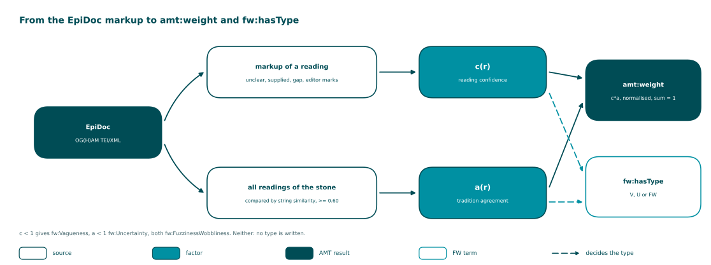

<!-- Generated by main.py (step: docs). Do not edit by hand; edit py/docs_text.py, ontology/ogham-amt.ttl or the data. -->

# Weights

The rule is the one of the first release (rule v1). It is unchanged; this release only makes
visible which factor lowered a weight.

| Step | What happens |
|---|---|
| 1. Reading confidence c(r) | For the current edition from the markup: `unclear`, `supplied` and `gap` lower it. For a historical reading, from the characters the editor marked as doubtful. A reading without any marker has c = 1. |
| 2. Tradition agreement a(r) | The share of the readings of the stone that cluster with this one, by string similarity of at least 0.60. |
| 3. Normalise | weight = c(r) * a(r) divided by the sum of c * a over all readings of the stone, rounded to four decimals. |
| 4. Type | c < 1 and a = 1: fw:Vagueness. a < 1 and c = 1: fw:Uncertainty. Both below 1: fw:FuzzinessWobbliness. Neither: no type is written, and AMT.engine reads the default fw:Vagueness. |

Source: [PNG](diagrams/03_weighting.png), drawn by `py/step_diagrams.py` from the data.

> The typing follows the Fuzziness-Wobbliness ontology: **vagueness** is a degree to which a
> reading is legible, **uncertainty** is doubt between alternatives. Whether a given marker belongs under one or the
> other is a scholarly decision. It is recorded in `py/step_convert.py` (`reading_type`) and is open for review
> (see the PRIMER, point D).
